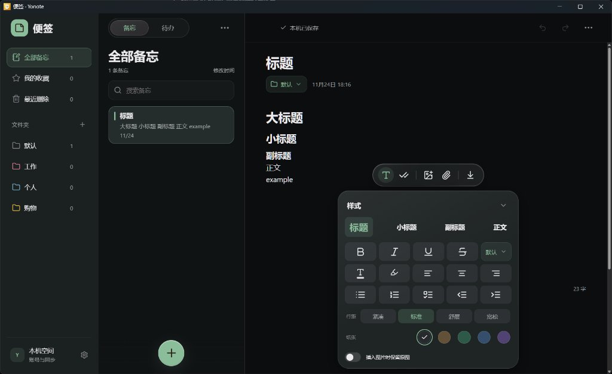
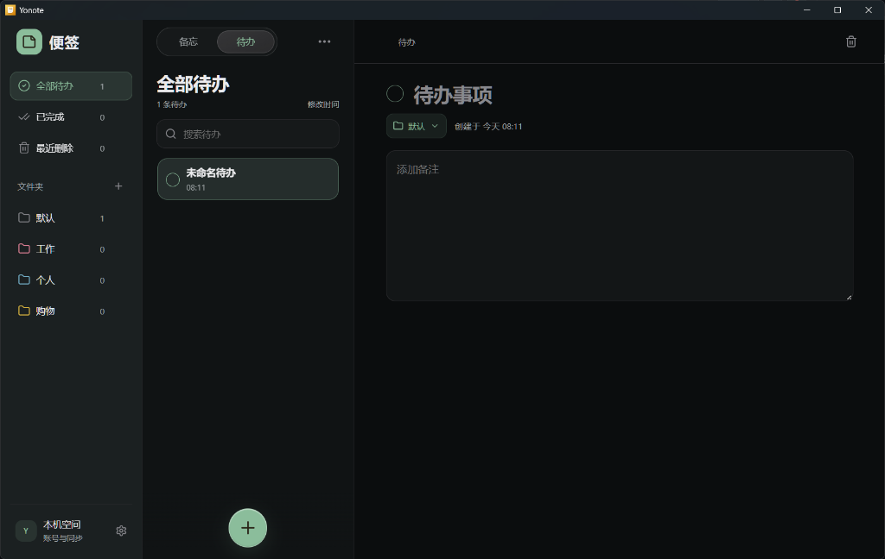

# Yonote

[简体中文](README.md) | English | [日本語](README.ja.md) | [한국어](README.ko.md)

Yonote is a self-hosted, cross-platform application for notes and tasks, available on Windows, Android, and the web (PWA). Data is stored locally by default for full offline use and synchronizes across devices when connected to your own server.





## Overview

- Rich-text notes supporting headings, text colors and highlights, checklists, line spacing, paper themes, images, and file attachments.
- Separate task management organized by folders, tracking creation and completion timestamps alongside task notes.
- Folder organization, pinning, favorites, manual reordering, date grouping, and full-text search.
- Local-first storage for offline reading and editing, with automatic incremental synchronization once connected to a server.
- Export to Markdown, long PNG images, or paginated PDF documents, as well as revocable read-only public share links.
- Automatic server-side revision snapshots with diff inspection and restore.
- Scoped API keys restricted by permissions and folder allowlists for connecting MCP-compatible AI clients.
- Interface available in Simplified Chinese, English, Japanese, and Korean; follows system or browser language by default and can be changed in Settings.

## Downloads

Prebuilt packages for each platform are published on [Releases](https://github.com/Yomihay-qut/yonote/releases/latest). Clients work standalone without a server; to enable sync, enter your server URL under **Settings → Account & Sync**.

| Platform | Package | Notes |
| --- | --- | --- |
| Android | `yonote-android-v*.apk` | For Android 7.0 and later |
| Windows (Installer) | `yonote-windows-setup-v*.exe` | Standard desktop installer |
| Windows (Portable) | `yonote-windows-portable-v*.exe` | Single portable executable |
| Web / PWA | Deployed server URL | Accessible via browser; installable as a PWA |

## Server Deployment

### Docker Compose

```bash
git clone https://github.com/Yomihay-qut/yonote.git
cd yonote
# Update YONOTE_PASSWORD (at least 12 characters) and YONOTE_ORIGIN in docker-compose.yml
docker compose up -d
```

### Linux Binary

Download `yonote-server-linux-amd64-v*.tar.gz` or the `arm64` archive from [Releases](https://github.com/Yomihay-qut/yonote/releases/latest). The executable includes the web frontend:

```bash
sudo tar -xzf yonote-server-linux-amd64-v1.0.0.tar.gz -C /opt/yonote
/opt/yonote/yonote -addr 127.0.0.1:8787 -data /var/lib/yonote
```

If no admin credentials are configured via environment variables, you can create the initial admin account from **Settings → Account & Sync** after starting the server. Refer to [docs/DEPLOYMENT.md](docs/DEPLOYMENT.md) for systemd, Nginx HTTPS reverse proxy, and backup setup.

## Development

Requirements: Node.js 22+ and Go 1.25+ (building Android requires JDK 21 and Android SDK 36; building Windows desktop requires Rust and MSVC).

```bash
# Start the frontend dev server (http://127.0.0.1:5178, proxies /api to 8788)
cd web
npm ci
npm run dev

# Start the backend server
cd server
go run . -addr 127.0.0.1:8788 -data ../data/dev
```

Run tests and builds:

```bash
cd web && npm test && npm run build
cd server && go vet ./... && go test -count=1 ./...
```

## Documentation & License

- [Architecture](docs/ARCHITECTURE.md)
- [Deployment Guide](docs/DEPLOYMENT.md)
- [Changelog](CHANGELOG.md)
- [Contributing](CONTRIBUTING.md)
- [Security Policy](SECURITY.md)

Licensed under the [MIT License](LICENSE).
