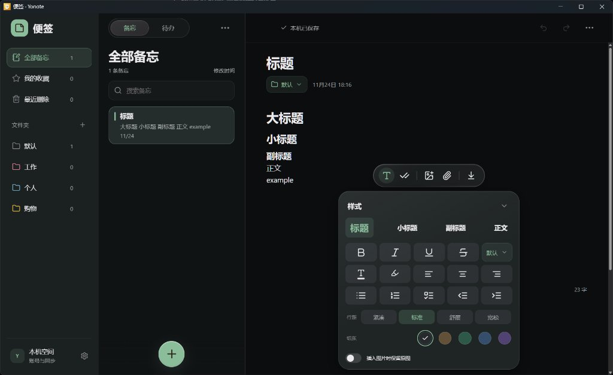
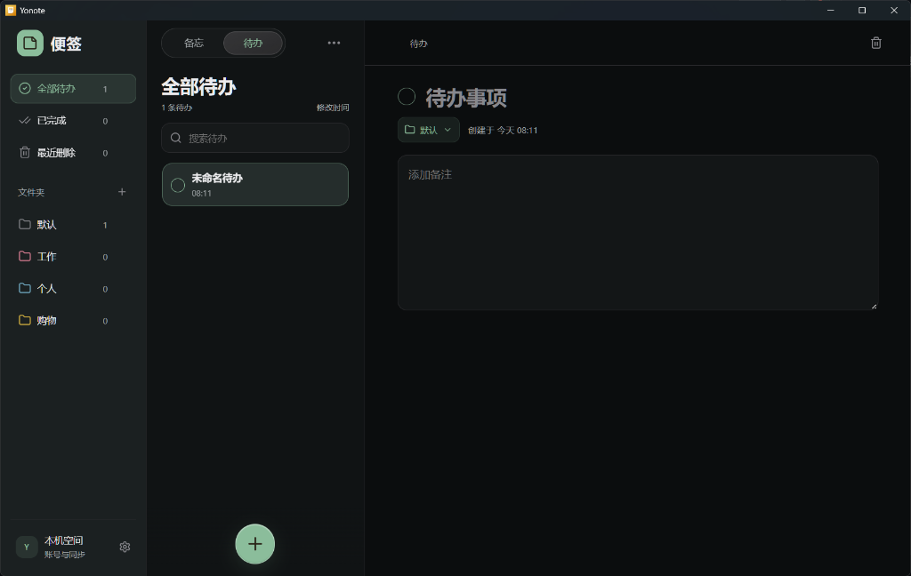

# Yonote

[简体中文](README.md) | [English](README.en.md) | 日本語 | [한국어](README.ko.md)

Yonote は、セルフホスト対応のクロスプラットフォーム向けメモ＆タスク管理アプリです。Windows デスクトップ、Android、Web（PWA）に対応しています。データは既定でローカルに保存され、オフラインのまま読み書きできるほか、自身のサーバーを運用して複数端末間で同期できます。





## 主な機能

- 見出し階層、文字色・ハイライト、チェックリスト、行間・用紙背景色、画像およびファイル添付に対応したリッチテキストメモ。
- フォルダー分類、作成・完了日時の記録、補足メモを備えたタスク管理。
- フォルダー整理、ピン留め、お気に入り、手動並び替え、日付グループ表示、全文検索。
- オフラインでも動作するローカル保存と、サーバー接続時の端末間自動差分同期。
- Markdown・ロング画像 PNG・ページ分割 PDF へのエクスポート、およびいつでも失効可能な閲覧専用共有リンク。
- サーバー側での履歴スナップショット保存と差分比較・復元。
- 権限およびアクセス対象フォルダーを制限した API キーの発行と、MCP 対応 AI クライアント連携。
- 簡体字中国語・English・日本語・한국어 に対応。既定ではシステムまたはブラウザの言語に追従し、設定から切り替え可能。

## クライアントのダウンロード

各プラットフォーム向けのパッケージは [Releases](https://github.com/Yomihay-qut/yonote/releases/latest) から入手できます。サーバーを用意しなくてもローカルアプリとして利用でき、同期を行う場合は「設定 → アカウントと同期」からサーバー URL を指定します。

| プラットフォーム | ファイル | 備考 |
| --- | --- | --- |
| Android | `yonote-android-v*.apk` | Android 7.0 以降対応 |
| Windows（インストーラー） | `yonote-windows-setup-v*.exe` | 標準インストーラー |
| Windows（ポータブル） | `yonote-windows-portable-v*.exe` | 単一実行ファイル（インストール不要） |
| Web / PWA | デプロイしたサーバー URL | ブラウザからアクセス、PWA インストールに対応 |

## サーバー構築

### Docker Compose

```bash
git clone https://github.com/Yomihay-qut/yonote.git
cd yonote
# docker-compose.yml の YONOTE_PASSWORD（12文字以上）と YONOTE_ORIGIN を環境に合わせて変更
docker compose up -d
```

### Linux バイナリ

[Releases](https://github.com/Yomihay-qut/yonote/releases/latest) から `yonote-server-linux-amd64-v*.tar.gz` または `arm64` 版をダウンロードします。実行ファイルには Web UI が組み込まれています。

```bash
sudo tar -xzf yonote-server-linux-amd64-v1.0.0.tar.gz -C /opt/yonote
/opt/yonote/yonote -addr 127.0.0.1:8787 -data /var/lib/yonote
```

環境変数で管理者アカウントを事前設定せずに起動した場合は、ブラウザまたはクライアントの「設定 → アカウントと同期」から最初の管理者アカウントを作成できます。systemd、Nginx HTTPS リバースプロキシ、定期バックアップの設定については [デプロイガイド](docs/DEPLOYMENT.md) を参照してください。

## ローカル開発

動作要件：Node.js 22+、Go 1.25+（Android ビルドには JDK 21 と Android SDK 36、Windows デスクトップビルドには Rust と MSVC が必要）。

```bash
# フロントエンド開発サーバーを起動（http://127.0.0.1:5178、/api を 8788 へプロキシ）
cd web
npm ci
npm run dev

# バックエンドサーバーを起動
cd server
go run . -addr 127.0.0.1:8788 -data ../data/dev
```

テストとビルドの実行：

```bash
cd web && npm test && npm run build
cd server && go vet ./... && go test -count=1 ./...
```

## ドキュメントとライセンス

- [アーキテクチャ](docs/ARCHITECTURE.md)
- [デプロイガイド](docs/DEPLOYMENT.md)
- [変更履歴](CHANGELOG.md)
- [コントリビュート](CONTRIBUTING.md)
- [セキュリティポリシー](SECURITY.md)

本プロジェクトは [MIT License](LICENSE) の下で公開されています。
