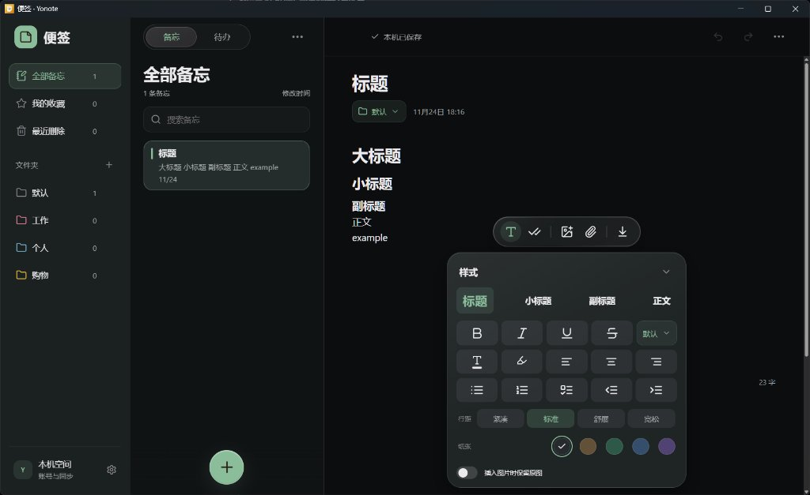
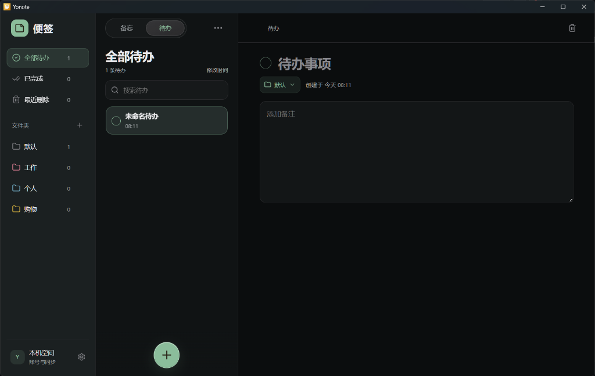

# Yonote

[简体中文](README.md) | [English](README.en.md) | [日本語](README.ja.md) | 한국어

Yonote는 Windows 데스크톱, Android 클라이언트, 웹(PWA)을 지원하는 셀프 호스팅 크로스 플랫폼 메모 및 할 일 애플리케이션입니다. 데이터는 기본적으로 로컬에 저장되어 오프라인 환경에서도 정상적으로 사용할 수 있으며, 개인 서버를 배포해 연결하면 여러 기기 간에 동기화됩니다.





## 주요 기능

- 제목 계층, 글자 색 및 강조 표시, 체크리스트, 줄 간격, 용지 배경색, 이미지와 파일 첨부를 지원하는 리치 텍스트 메모.
- 폴더별 분류, 생성·완료 시각 기록 및 메모 첨부가 가능한 독립적인 할 일 모듈.
- 폴더 관리, 상단 고정, 즐겨찾기, 수동 정렬, 날짜별 그룹 보기 및 전체 검색.
- 오프라인 읽기와 쓰기를 지원하는 로컬 저장 및 개인 서버 연결 시 기기 간 자동 증분 동기화.
- Markdown, 긴 이미지(PNG), 페이지 분할 PDF 내보내기 및 언제든 해지 가능한 읽기 전용 공개 공유 링크.
- 서버 측 편집 스냅샷 자동 저장과 버전 기록 차이 비교 및 복원.
- 권한과 접근 가능 폴더 범위가 제한된 API 키를 발급해 MCP 호환 AI 클라이언트와 연동.
- 중국어 간체, English, 日本語, 한국어 인터페이스를 기본 탑재하며 시스템·브라우저 언어에 자동 맞춤(설정에서 변경 가능).

## 클라이언트 다운로드

각 플랫폼용 패키지는 [Releases](https://github.com/Yomihay-qut/yonote/releases/latest)에서 받을 수 있습니다. 서버 연결 없이 로컬 앱으로도 사용 가능하며, 동기화가 필요한 경우 **설정 → 계정 및 동기화**에 서버 주소를 입력하면 됩니다.

| 플랫폼 | 배포 파일 | 설명 |
| --- | --- | --- |
| Android | `yonote-android-v*.apk` | Android 7.0 이상 지원 |
| Windows (설치형) | `yonote-windows-setup-v*.exe` | 표준 데스크톱 설치 프로그램 |
| Windows (포터블) | `yonote-windows-portable-v*.exe` | 설치가 필요 없는 단일 실행 파일 |
| 웹 / PWA | 배포된 서버 주소 | 브라우저 접속 및 PWA 앱 설치 지원 |

## 서버 배포

### Docker Compose

```bash
git clone https://github.com/Yomihay-qut/yonote.git
cd yonote
# docker-compose.yml의 YONOTE_PASSWORD(12자 이상)와 YONOTE_ORIGIN을 환경에 맞게 수정
docker compose up -d
```

### Linux 바이너리

[Releases](https://github.com/Yomihay-qut/yonote/releases/latest)에서 `yonote-server-linux-amd64-v*.tar.gz` 또는 `arm64` 파일을 내려받습니다. 실행 파일 안에 웹 리소스가 포함되어 있습니다.

```bash
sudo tar -xzf yonote-server-linux-amd64-v1.0.0.tar.gz -C /opt/yonote
/opt/yonote/yonote -addr 127.0.0.1:8787 -data /var/lib/yonote
```

환경 변수로 관리자 계정을 미리 지정하지 않았더라도 서버 시작 후 웹이나 클라이언트의 **설정 → 계정 및 동기화**에서 첫 관리자 계정을 생성할 수 있습니다. systemd 서비스, Nginx HTTPS 리버스 프록시 및 백업 구성은 [배포 가이드](docs/DEPLOYMENT.md)를 참고하세요.

## 로컬 개발

필요 환경: Node.js 22+, Go 1.25+ (Android 빌드는 JDK 21 및 Android SDK 36, Windows 데스크톱 빌드는 Rust 및 MSVC 필요).

```bash
# 프론트엔드 개발 서버 실행 (http://127.0.0.1:5178, /api를 8788로 프록시)
cd web
npm ci
npm run dev

# 백엔드 서버 실행
cd server
go run . -addr 127.0.0.1:8788 -data ../data/dev
```

테스트 및 빌드:

```bash
cd web && npm test && npm run build
cd server && go vet ./... && go test -count=1 ./...
```

## 문서 및 라이선스

- [아키텍처](docs/ARCHITECTURE.md)
- [배포 가이드](docs/DEPLOYMENT.md)
- [변경 이력](CHANGELOG.md)
- [기여 가이드](CONTRIBUTING.md)
- [보안 정책](SECURITY.md)

본 프로젝트는 [MIT License](LICENSE)를 따릅니다.
