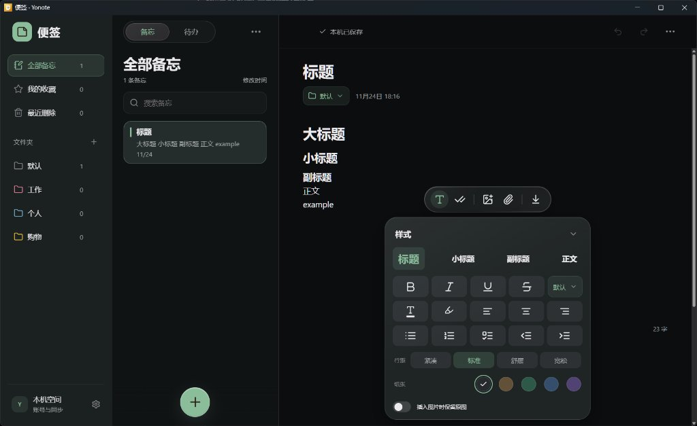
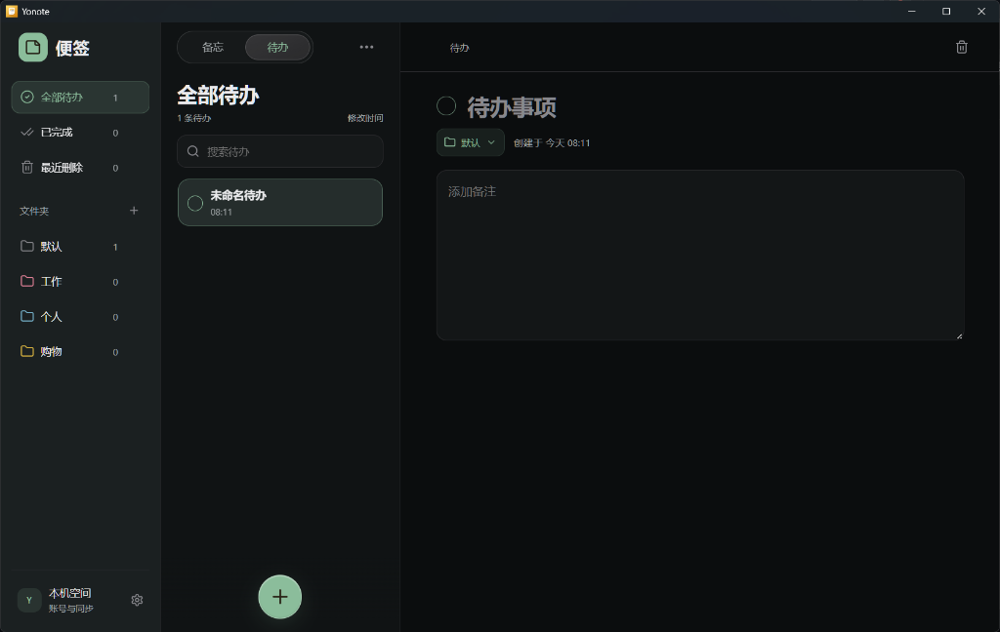

# 便签 · Yonote

简体中文 | [English](README.en.md) | [日本語](README.ja.md) | [한국어](README.ko.md)

<p>
  <a href="LICENSE"></a>
  
  
  
  
  <a href="https://github.com/Yomihay-qut/yonote/releases"></a>
</p>

Yonote 是一款可自托管的跨平台备忘与待办应用，提供 Windows 桌面端、Android 客户端与网页端（PWA）。数据默认存储在本地，可在离线状态下正常使用；部署私人服务端后，支持在多台设备间同步。





## 功能概览

- 富文本备忘录，包含标题层级、文字颜色与高亮、勾选清单、行距与纸张底色、图片及文件附件。
- 独立的待办事项模块，按文件夹归类，记录创建与完成时间，并可附加备注。
- 文件夹管理、置顶、收藏、手动排序、按日期分组与全文检索。
- 数据默认保存在本地，断网可正常读写，连接私人服务器后自动在各设备间增量同步。
- 导出为 Markdown、长图 PNG 或分页 PDF，支持生成可随时撤销的公开只读分享链接。
- 服务端自动保存编辑快照，提供历史版本差异对比与恢复。
- 可在设置页创建受权限与文件夹范围约束的 API 密钥，供支持 MCP 的 AI 客户端访问笔记与待办。
- 内置简体中文、English、日本語、한국어 四种界面语言，默认跟随系统或浏览器语言，可在设置中切换。

## 客户端下载

各平台安装包均发布在 [Releases](https://github.com/Yomihay-qut/yonote/releases/latest)。客户端无需连接服务器即可作为本地应用使用；如需多端同步，在「设置 → 账号与同步」中填写服务端地址即可。

| 平台 | 发行文件 | 说明 |
| --- | --- | --- |
| Android | `yonote-android-v*.apk` | 适用于 Android 7.0 及以上系统 |
| Windows（安装版） | `yonote-windows-setup-v*.exe` | 标准桌面安装程序 |
| Windows（便携版） | `yonote-windows-portable-v*.exe` | 单文件可执行程序，无需安装 |
| 网页端 / PWA | 部署后的服务端地址 | 浏览器访问，支持安装为 PWA |

## 服务端部署

### Docker Compose

```bash
git clone https://github.com/Yomihay-qut/yonote.git
cd yonote
# 修改 docker-compose.yml 中的 YONOTE_PASSWORD（至少 12 位）与 YONOTE_ORIGIN
docker compose up -d
```

### Linux 预编译包

从 [Releases](https://github.com/Yomihay-qut/yonote/releases/latest) 下载 `yonote-server-linux-amd64-v*.tar.gz` 或 `arm64` 版本，可执行文件已包含网页端静态资源：

```bash
sudo tar -xzf yonote-server-linux-amd64-v1.0.0.tar.gz -C /opt/yonote
/opt/yonote/yonote -addr 127.0.0.1:8787 -data /var/lib/yonote
```

如未通过环境变量预设管理员账号，可在服务启动后通过网页端或客户端的「设置 → 账号与同步」创建首个管理员账号。systemd 服务、Nginx HTTPS 反向代理及备份方案见 [部署文档](docs/DEPLOYMENT.md)。

## 本地开发

环境要求：Node.js 22+、Go 1.25+（构建 Android 需 JDK 21 与 Android SDK 36；构建 Windows 桌面端需 Rust 与 MSVC）。

```bash
# 启动前端开发服务（http://127.0.0.1:5178，自动代理 /api 至 8788）
cd web
npm ci
npm run dev

# 启动后端服务
cd server
go run . -addr 127.0.0.1:8788 -data ../data/dev
```

运行测试与构建：

```bash
cd web && npm test && npm run build
cd server && go vet ./... && go test -count=1 ./...
```

## 文档与许可

- [架构说明](docs/ARCHITECTURE.md)
- [部署文档](docs/DEPLOYMENT.md)
- [更新日志](CHANGELOG.md)
- [贡献指南](CONTRIBUTING.md)
- [安全策略](SECURITY.md)

本项目基于 [MIT License](LICENSE) 开源。
