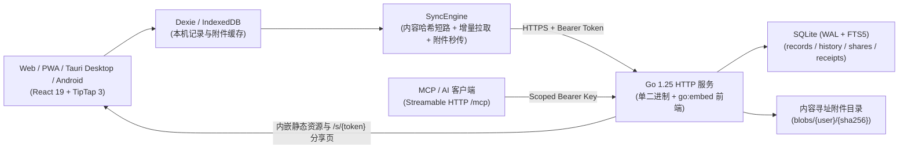

# 架构设计

Yonote 采用**离线优先（Offline-First）+ 轻量自托管单二进制**架构，Web、PWA、Windows 桌面客户端（Tauri v2）与 Android（Capacitor 8）共用同一套 React 前端代码；服务端通过 `go:embed` 直接内嵌前端资源，支持零前置环境变量的网页首次初始化（`GET/POST /api/setup`）。

## 系统总览

## 核心设计

### 1. 离线优先与状态增量同步
- **本地优先读写**：编辑与排序先写入本机 IndexedDB（`web/src/store.ts`），无网络也可正常新建、修改、搜索与导出。
- **内容 SHA-256 哈希短路**：客户端对记录规范化内容计算 SHA-256（`syncedHash`）；未实质修改或改回原样时不标记脏数据，服务端也会用 `content_hash` 短路相同内容写入，减少冗余流量与历史快照。
- **基于单调版本号的拉取**：服务端通过 `sync_seq` 维护单调递增版本号，直接从 `records(user_id, version)` 增量拉取变更，并跳过当前客户端刚确认的自身回声。
- **幂等回执与冲突保护**：出站提交带 `opId` 与 `base` 版本号；并发冲突时保留冲突副本不丢数据；历史回执定期按 14 天清理。
- **附件去重秒传**：上传前先计算文件 SHA-256 调用 `POST /api/attachments/check`，服务端已有相同内容块时直接复用。

### 2. 语义色彩令牌系统（`web/src/palette.ts`）
- 笔记纸张（`warm` / `sage` / `sky` / `lavender`）、字色（`amber` / `red` / `blue` / `green` / `purple` / `orange` / `gray`）与荧光高亮（6 色）均以**语义名**而非裸 Hex 持久化。
- 通过 CSS 变量在深浅主题、公开分享页、PNG 导出与打印间自动映射为 WCAG AA 达标色值，同时保持历史旧色值的无迁移向后兼容。
- 粘贴外部富文本时自动净化非站内杂乱 `color` / `background-color` / `font-family`，避免深色模式出现黑底黑字。

### 3. 真矢量 PDF 与多格式导出（`web/src/export.ts`）
- 导出前抽离编辑器纯净正文（剥离 UI 控件、同步勾选状态、内联本地 `blob:` 图片为 `data:` URL），组装标准 `@page` 无 Flex 流式打印文档。
- **Web / PWA**：通过隐藏 `iframe` 唤起浏览器原生矢量 PDF/打印引擎，真矢量、可选字、可搜索且自动分页。
- **Android APK**：通过 `@capgo/capacitor-printer` 调用系统原生 `PrintManager`，同样输出真矢量 PDF。
- **PNG 长图 & Markdown**：长图复用了同一份去杂质纯净正文，`MarkdownManager` 负责标准 Markdown 序列化。

### 4. Scoped AI API 与 MCP（`server/agent.go`、`server/mcp.go`）
- 支持签发独立前缀掩码展示的 Bearer Key，按权限（`read` / `write` / `todo`）和指定文件夹白名单严格鉴权。
- 提供 REST 接口（`/api/agent/*`）及 Streamable HTTP MCP 协议端点（`/mcp`），方便各类 AI 客户端安全读写笔记与待办。

## 关键源码目录

| 路径 | 职责 |
| --- | --- |
| `web/src/App.tsx` | 三栏/双栏/单栏响应式工作区、导航与主题控制 |
| `web/src/editor.tsx` | TipTap 富文本编辑器、语义色扩展、选区保持与样式面板 |
| `web/src/palette.ts` | 语义纸张、字色、高亮注册表与旧色兼容映射 |
| `web/src/export.ts` | 纯文档构建器、Web/Android 真矢量打印与 PNG/MD 导出 |
| `web/src/store.ts` / `sync.ts` | IndexedDB 存储、内容哈希计算与增量同步引擎 |
| `web/src/panels.tsx` | 设置中心、AI 密钥、用户管理、历史 Diff 对比与公开分享 |
| `server/main.go` | HTTP 路由、SQLite 架构迁移、登录鉴权与同步核心 |
| `server/files.go` | 附件秒传/上传/下载、公开分享、设备与用户管理 |
| `server/agent.go` / `mcp.go` | Scoped AI API 与 Streamable HTTP MCP 服务 |
